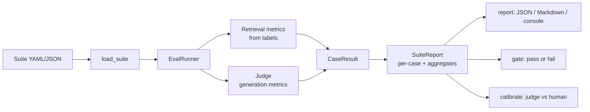
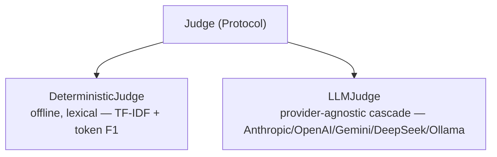

# Architecture

## Goal

Measure the quality of a RAG or LLM system in a way that is repeatable, that you can
trust, and that can block a bad change in CI.

## Components

| Layer | Module | What it does |
|---|---|---|
| Data model | `schemas.py` | `Suite`, `EvalCase`, `SuiteReport` as pydantic models |
| Metrics | `metrics/` | Retrieval metrics (from labels) and lexical similarity |
| Judges | `judges/` | The `Judge` interface, a deterministic judge, a provider-agnostic LLM judge |
| Runner | `runner.py` | Runs a suite and returns a report |
| Gate | `gate.py` | Fails CI when a metric is below its threshold |
| Calibration | `calibrate.py` | Compares judge scores with human scores |
| Output | `report.py` | JSON, Markdown, and console tables |
| Tracing | `tracing.py` | Optional OpenTelemetry spans |
| CLI | `cli.py` | `run`, `gate`, `calibrate` |

## How a run works

For each case, the runner does two things:

1. **Retrieval metrics** come straight from the relevance labels. No model is involved,
   so these are ground truth.
2. **Generation metrics** come from the judge. The judge scores `faithfulness`,
   `answer_relevance`, and (when there is a ground truth) `answer_correctness`.

The runner then averages each metric over all cases to get the aggregate scores.

## Why the judge is an interface

`EvalRunner` does not know which judge it uses. It depends on the `Judge` protocol in
`judges/base.py`:

This has two benefits. First, every test runs with the deterministic judge, so the test
suite needs no API key and no network. Second, you can start with the cheap judge and
move to the LLM judge only where you need it — the code change is one flag.

## Why calibration matters

An automated judge is only useful if it agrees with people. `calibrate.py` takes human
scores for the same cases and metrics, then reports, per metric:

* **Pearson** and **Spearman** correlation between judge and human scores.
* **Mean absolute error** (MAE).

A low correlation is a warning: do not gate anything important on that judge and that
metric. This is why the tool ships with a calibration command and not just a score.

## The CI gate

`gate.py` takes a report and a set of minimum scores. It passes only if every metric
meets its minimum. The CLI returns a non-zero exit code on failure, so a regression
fails the pull request.

## Configuration

Settings use the `EF_` prefix (see `.env.example`): the judge, the similarity threshold
for the faithfulness check, and whether to emit OpenTelemetry spans. The LLM judge
reads `ANTHROPIC_API_KEY` from the environment.
